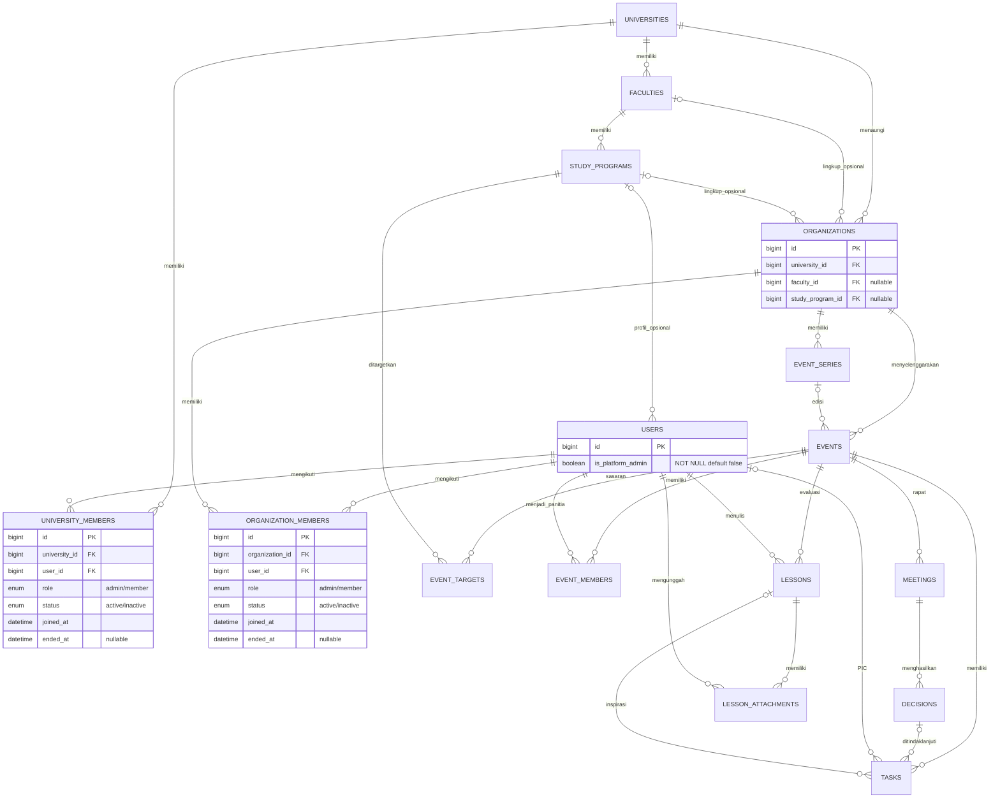

# ERD & PDM — University MVP v1.1

Web dan Android memakai satu backend Laravel dan satu database MySQL untuk universitas pilot. Migration awal membuat **15 tabel domain**. Dua migration aditif menambah tabel lampiran dan dua kolom media, sehingga schema saat ini mencakup **16 tabel domain** di luar tabel pencatat migration. Bagian 7–11 mencatat hasil dan batas pemeriksaan pada fase terdahulu.

## 1. ERD logis

## 2. PDM berdasarkan migration yang tersedia

`id` dan FK = BIGINT UNSIGNED. Tabel selain pivot event_targets memiliki created_at/updated_at nullable TIMESTAMP standar Laravel. Waktu aplikasi dan koneksi MySQL UTC. Semua foreign key menggunakan RESTRICT saat delete/update (eksplisit atau default) agar penghapusan induk tidak menghilangkan data kegiatan; urutan rollback migration terbalik. Tidak ada soft delete global, polymorphic atau JSON relasional.

| Tabel | Kolom selain timestamps | Constraint / indeks |
| --- | --- | --- |
| universities | id, name VARCHAR(160), code VARCHAR(30) | PK id, UNIQUE code |
| faculties | id, university_id, name VARCHAR(160), code VARCHAR(30) | FK universitas; UNIQUE (university_id,code), UNIQUE (id,university_id) untuk composite FK |
| study_programs | id, faculty_id, name VARCHAR(120), code VARCHAR(20) | FK fakultas; UNIQUE (faculty_id,code), UNIQUE (id,faculty_id) untuk composite FK |
| users | id, study_program_id NULL, name VARCHAR(150), email VARCHAR(190), password VARCHAR(255), is_platform_admin BOOLEAN NOT NULL DEFAULT FALSE, remember_token VARCHAR(100) NULL | FK prodi opsional; UNIQUE email; remember_token adalah dukungan model auth standar, fitur remember-me tidak disediakan |
| university_members | id, university_id, user_id, role ENUM(admin,member) DEFAULT member, status ENUM(active,inactive) DEFAULT active, joined_at DATETIME, ended_at DATETIME NULL | FK; UNIQUE (university_id,user_id); indeks (user_id,status); ended_at NULL atau > joined_at |
| organizations | id, university_id, faculty_id NULL, study_program_id NULL, name VARCHAR(160), logo_path VARCHAR(255) NULL | FK universitas, FK komposit lingkup (lihat bawah); indeks university_id |
| organization_members | id, organization_id, user_id, role ENUM(admin,member) DEFAULT member, status ENUM(active,inactive) DEFAULT active, joined_at DATETIME, ended_at DATETIME NULL | FK; UNIQUE (organization_id,user_id); indeks (user_id,status); ended_at NULL atau > joined_at |
| event_series | id, organization_id, name VARCHAR(180) | FK organisasi; UNIQUE (id,organization_id) untuk composite FK |
| events | id, organization_id, event_series_id NULL, title VARCHAR(200), description TEXT NULL, starts_at DATETIME, ends_at DATETIME, venue VARCHAR(160) NULL, status ENUM(draft,published,completed,cancelled) DEFAULT draft, published_at DATETIME NULL, poster_path VARCHAR(255) NULL | FK organisasi; FK komposit (event_series_id,organization_id); ends_at > starts_at; indeks (status,starts_at,ends_at), (event_series_id,starts_at) |
| event_targets | event_id, study_program_id | PK gabungan, dua FK; tanpa id/timestamps |
| event_members | id, event_id, user_id, role ENUM(coordinator,member) DEFAULT member | FK; UNIQUE (event_id,user_id) |
| meetings | id, event_id, title VARCHAR(180), scheduled_at DATETIME, notes TEXT NULL | FK event |
| decisions | id, meeting_id, summary TEXT, rationale TEXT NULL | FK rapat |
| lessons | id, event_id, created_by, problem TEXT, recommendation TEXT, visibility ENUM(event,series) DEFAULT event, approved_at DATETIME NULL | FK event dan pembuat; approved_at hanya untuk visibility series |
| lesson_attachments | id, lesson_id, uploaded_by, original_name VARCHAR(255), path VARCHAR(255), mime_type VARCHAR(127), size_bytes INT UNSIGNED | FK lesson dan pengunggah; UNIQUE path |
| tasks | id, event_id, decision_id NULL, assignee_user_id NULL, source_lesson_id NULL, title VARCHAR(200), status ENUM(todo,in_progress,done) DEFAULT todo, due_at DATETIME NULL | FK event/decision/lesson; FK komposit (event_id,assignee_user_id) ke event_members(event_id,user_id); indeks (event_id,status) |

## 3. Integritas lingkup organisasi

Tidak perlu kolom level: lingkup diturunkan dari FK.

| Lingkup | university_id | faculty_id | study_program_id |
| --- | --- | --- | --- |
| Universitas | wajib | NULL | NULL |
| Fakultas | wajib | wajib | NULL |
| Program studi | wajib | wajib | wajib dan milik fakultas tersebut |

FK `(faculty_id, university_id)` mengacu ke `faculties(id, university_id)`; FK `(study_program_id, faculty_id)` mengacu ke `study_programs(id, faculty_id)`. CHECK `study_program_id IS NULL OR faculty_id IS NOT NULL` mencegah bypass composite FK melalui NULL. Kombinasi FK dan CHECK ini dirancang menolak rujukan fakultas/prodi universitas lain. Pada dua FK lingkup organisasi, klausul ON DELETE/ON UPDATE eksplisit sengaja dihilangkan (default RESTRICT), karena MySQL membatasi aksi referensial pada kolom yang digunakan CHECK. Enforcement diverifikasi pada MySQL 9.7.2 lokal sebagaimana dicatat di bagian 7. faculty_id pada organisasi prodi adalah discriminator lingkup dan jangkar composite FK; redundansi terkendali ini diperlukan untuk integritas lintas tingkat, bukan salinan nama/identitas universitas pada semua tabel.

MySQL **8.0.16+** diperlukan untuk CHECK yang enforced. Pengujian lokal historis memakai MySQL 9.7.2. Migration menambahkan CHECK MySQL untuk bentuk organisasi, masa membership, urutan waktu event, dan approved_at lesson. Pada SQLite terisolasi untuk tes fondasi, CHECK MySQL ini dilewati; hasil SQLite bukan bukti CHECK/ENUM/DDL MySQL. Deployment wajib menguji schema pada MySQL. FK komposit dan UNIQUE disiapkan pada kedua engine.

Universitas pilot tidak dibuat otomatis dari data fiktif. Tabel universitas bukan implementasi multi-tenancy v1.2: belum ada routing tenant, onboarding, billing, atau pemilihan institusi saat register.

## 4. Membership dan otorisasi

- Satu record per pasangan universitas–user atau organisasi–user. Status active/inactive, joined_at wajib, ended_at opsional. Berlaku ketika active, joined_at <= now, dan ended_at NULL atau now < ended_at. Tepat pada ended_at hak berakhir; tidak memerlukan scheduler.
- Register hanya name/email/password, hash bawaan Laravel, is_platform_admin default false. Tidak menerima role, university_id, organization_id, membership, maupun flag admin sebagai pemberian hak.
- Platform admin hanya melalui proses tepercaya: membuat universitas dan admin universitas pertama. Admin universitas melalui university_members admin yang berlaku mengelola struktur/administrasi awal organisasi pada universitas sendiri, termasuk admin organisasi pertama.
- Admin organisasi melalui organization_members admin berlaku mengelola organisasi/event/panitia, menunjuk ketua, publikasi/approval lesson, dan membaca workspace/arsip organisasi sendiri.
- Admin platform/universitas tidak memiliki bypass akses privat. Event leader memakai role teknis coordinator, mengelola anggota biasa, rapat, keputusan, tugas dan evaluasi event sendiri; tidak otomatis menjadi admin organisasi.
- Event membership tidak memiliki masa/status tersendiri di MVP; keberadaan record memberikan izin event sesuai role. Berakhirnya membership organisasi tidak menghapusnya. Pencabutan panitia harus menangani task yang ditugaskan terlebih dahulu (FK komposit membatasi penghapusan).
- Anggota organisasi biasa tidak otomatis membaca workspace. Anggota event hanya memperbarui progres task miliknya.
- Profil study_program_id opsional tidak membuktikan membership organisasi/universitas atau identitas email. Demo tertutup membutuhkan pemeriksaan identitas manual; email verification belum termasuk MVP.

## 5. Integritas event, tugas dan legacy yang tetap berlaku

- Event sekali jalan boleh event_series_id NULL. Composite FK menjamin edisi dan seri memiliki organisasi sama.
- Satu seri Lomba A dapat memiliki edisi 2026/2027/2028. Panitia, rapat, keputusan, tugas dan evaluasi tiap edisi tetap terpisah; tidak disalin otomatis.
- Server memvalidasi bahwa tasks.decision_id berasal dari rapat event yang sama. FK decision menjaga keberadaan keputusan.
- PIC harus anggota event yang sama (FK komposit dan validasi aplikasi). Admin organisasi tanpa event membership tidak boleh menjadi PIC tanpa didaftarkan terlebih dahulu.
- Server membatasi source_lesson_id pada evaluasi yang disetujui dan memenuhi aturan pewarisan seri, organisasi, serta urutan edisi. FK menjaga keberadaan evaluasi sumber.
- Publik hanya metadata dengan published_at terisi dan status published/completed/cancelled; draft selalu privat meski pernah terpublikasi. Notulen, tugas, daftar panitia dan lesson privat tidak disertakan pada respons publik.
- Konflik mengecualikan diri sendiri, draft dan cancelled; hanya event terpublikasi published/completed yang diperiksa. Interval `[start,end)`: startA < endB dan startB < endA. Lokasi sama atau target prodi beririsan menghasilkan warning, bukan pembatalan. Venue NULL bukan lokasi sama. Tidak menjamin semua agenda kampus tercakup.
- Scope event_targets lintas fakultas tetap prodi; tidak menambah polymorphic target. Pada mutasi, server memvalidasi prodi target terhadap universitas organisasi event.
- Simpan UTC, tampilkan Asia/Makassar. Validasi aplikasi wajib untuk rentang tanggal dan relasi lintas objek selain constraint DB.

## 6. Migration dan penerapan aman

Migration awal membuat 15 tabel menurut urutan dependensi. Migration lampiran membuat lesson_attachments, lalu migration media menambah poster_path dan logo_path. Konfigurasi file untuk sesi/cache dan sync untuk antrean memakai penyimpanan di luar tabel domain. Fitur reset password belum tersedia.

Sebelum `php artisan migrate`, periksa koneksi, SELECT VERSION(), SHOW TABLES, dan `php artisan migrate:status`; cocokkan schema existing dan backup bila berisi data. Jangan migrate:fresh, reset, atau menjalankan SQL lama. Jika DB tidak bisa diperiksa, migration disiapkan tetapi tidak diterapkan. Keberadaan tabel/flag di schema tidak berarti endpoint administratif atau fitur bisnisnya telah selesai.

Rujukan [batas CHECK MySQL](https://dev.mysql.com/doc/refman/8.4/en/create-table-check-constraints.html) dan integritas FK: [MySQL 8.4 FK constraints](https://dev.mysql.com/doc/refman/8.4/en/create-table-foreign-keys.html). Standar Laravel migration/model tetap digunakan tanpa repository/service tambahan.

## 7. Hasil penerapan lokal — 18 November 2026

Database evaloop pada MySQL 9.7.2 diperiksa kosong sebelum `php artisan migrate --no-interaction`. Migration berhasil batch 1; status Ran dan pengulangan Nothing to migrate. Terbentuk 15 tabel domain + tabel migrations, dengan 5 CHECK. Sebanyak 13 pemeriksaan MySQL (termasuk FK komposit lingkup organisasi, CHECK nullable scope/rentang tanggal/approval, UNIQUE dan ENUM) lulus. Data simulasi dijalankan dalam transaksi yang selalu di-rollback; seluruh tabel domain kembali kosong. Tidak ada reset, perubahan migration source, penghapusan data existing, atau seeding institusi. Ini membuktikan penerapan lokal MySQL 9.7.2, bukan pengujian seluruh versi MySQL 8.x atau seluruh fitur bisnis.

## 8. Riwayat Phase 3 — review schema sebelum aktivasi mutasi

14 model dan relasi universitas/fakultas/prodi, membership, seri/edisi, target dan panitia dipertahankan. Hash migration dan manifest dependency sama dengan awal Phase 3; tidak ada migration baru atau perubahan ERD/PDM. Status organisasi tidak ada pada organizations dan tidak ditambahkan; UI tidak merekayasa statusnya.

Semua route penulisan Phase 3 masih scaffold 501 tanpa write. Form Request memeriksa relasi seri/organisasi dan prodi/universitas, pasangan membership unik, masa keanggotaan dan field terlindungi. Ini tidak menggantikan FK/CHECK MySQL atau transaksi dan otorisasi ulang saat tim mengimplementasikan persistence. Last-admin concurrency, coordinator replacement, target sync, transisi status event, decision/event dan lesson/series consistency tetap perlu implementasi pada fitur terkait.

Seeder belum dibuat/dijalankan pada Phase 3. Hanya fixture berlabel Simulation pada SQLite in-memory untuk tes. Rencana seeding tim: periksa universitas pilot existing; gunakan akun terdaftar yang disetujui, identifier simulasi yang konsisten dan transaksi; cari record existing tanpa update/menimpa nama/role/password milik pengguna. Hindari membuat universitas kedua saat pilot sudah ada. Password akun baru, bila diperlukan, berasal dari input aman atau nilai acak yang disampaikan di lingkungan lokal, bukan hardcoded di repo. Bila natural key fixture ambigu, hentikan untuk review daripada menghapus/menggabungkan data.

## 9. Riwayat Phase 3B — kontrak transaksi sebelum implementasi

Schema, FK/unique/CHECK dan 14 model tetap dipertahankan. Tidak ada alasan menambah status organisasi, service/repository atau tabel baru untuk operasi berikut.

| Operasi | Unit atomik yang perlu diterapkan tim |
| --- | --- |
| B01 organisasi + admin pertama | DB::transaction mencakup kedua insert; parent universitas dan kewenangan UA diperiksa lagi; kegagalan admin membatalkan organisasi |
| B03/B04 membership organisasi | Serialize melalui lock parent organization; baca target/admin berlaku dengan lock; recheck actor dan guard admin terakhir di dalam transaksi, bukan hanya validasi HTTP |
| B05/B06 event + targets | Organization/event dari route berizin; konversi WITA→UTC; insert/update metadata dan sync target di satu transaction; tidak menerima status/published_at dari mass assignment |
| B07/B13 publish/cancel | Lock event dan recheck izin/status; timestamp dari server; perubahan state minimal dan konsisten, tanpa menghapus data historis |
| B09/B10/B11 panitia | Lock parent event dan target membership; unique pair tetap pertahanan terakhir; pengeluaran memeriksa semua rujukan tasks sebelum delete |
| B12 ganti ketua | Lock parent event, baca coordinator existing dan target; buat/naikkan target lalu turunkan coordinator lama menjadi member secara atomik. Jangan hapus membership ketua lama atau task-nya otomatis |

Gunakan urutan lock konsisten untuk semua writer yang berkaitan (parent universitas bila diperlukan → organisasi → event → membership/task), bukan pola berbeda pada setiap controller. Kewenangan yang lolos Form Request dapat berubah sebelum transaksi; recheck actor setelah lock. DB::transaction bukan pengganti otorisasi, validasi relasi, atau aturan state. Unique validation sebelum insert tidak mencegah race; tangani constraint error yang dikenal sebagai validation/conflict tanpa menampilkan SQL. Jangan menelan exception di dalam closure lalu mengembalikan sukses, karena itu dapat membuat transaksi ter-commit.

### Admin terakhir

Persyaratan pengguna: jangan menonaktifkan/menurunkan admin terakhir tanpa pengganti. Penjaga ini **belum diimplementasikan** pada stub B04. Tim perlu menghitung admin yang benar-benar berlaku setelah calon perubahan (role, status, joined_at, ended_at) di bawah lock organisasi, bukan menghitung semua row role=admin. Pengganti harus sudah berlaku. Uji perubahan paralel dua admin dan role/status/tanggal yang menyebabkan tidak ada admin berlaku. Larangan mengubah role sendiri pada Request tetap berlaku, tetapi tidak cukup untuk mencegah kehilangan admin terakhir lewat status/tanggal. Membership yang berakhir secara alami tetap tunduk aturan masa berlaku; prosedur serah terima diperlukan.

### Usulan pengeluaran panitia — belum diterapkan dan perlu kesepakatan tim

**Usulan paling konservatif tanpa perubahan schema:** tolak pengeluaran bila masih ada task yang menunjuk anggota itu, beri respons konflik yang jelas; jangan otomatis menghapus tugas, mengosongkan PIC, atau mengubah riwayat. Untuk tugas aktif, penanggung jawab harus ditangani lewat aksi terpisah yang berwenang terlebih dahulu.

Penting: FK `(event_id,assignee_user_id)` mengacu pada event_members dan tetap berlaku untuk task **done**, bukan hanya todo/in_progress. Karena itu mengecek tugas aktif saja tidak cukup. Pengeluaran dengan rujukan task done juga harus ditolak sampai tim menyepakati proses eksplisit; jangan menonaktifkan FK untuk meloloskannya. Pertahankan archive dan jelaskan konsekuensi akses bila membership belum dapat dicabut. Jika kebutuhan pencabutan akses sambil mempertahankan seluruh atribusi memerlukan perubahan schema, review terpisah dahulu; tidak dilakukan pada fase ini.

### Hasil MySQL aktual review 3B

MySQL 9.7.2: 16 tabel, 5 CHECK, seluruh tabel InnoDB; migration tetap [1] Ran. Probe DB::transaction membuat dua row berlabel SIMULASI, memaksa exception, lalu membuktikan kedua row tidak tersisa. Ini bukti rollback pada database lokal, **bukan** bukti B01–B13 sudah transactional: semua controller mutasi tetap 501. Tidak ada schema/reset/overwrite data existing.

## 10. Riwayat Phase 3C — Event Series

Create Event Series hanya menulis satu row event_series dengan organization_id dari relasi route dan name tervalidasi. Satu INSERT InnoDB atomik; tidak perlu menciptakan unit multi-record atau service layer. Bila kebijakan aplikasi memerlukan sinkronisasi ketat dengan perubahan hak admin, gunakan transaksi parent lock + recheck sesuai protokol writer membership pada bagian 9; Form Request di luar transaksi saja bukan bukti serialisasi.

Tidak ada unique constraint nama seri per organisasi; hanya PK id dan unique komposit (id,organization_id) untuk FK edisi. Jangan menyamakan unique komposit tersebut dengan uniqueness nama. Tidak ada data workspace yang disalin ketika seri dibuat.

Audit read-only 3C pada MySQL 9.7.2: migration tetap [1] Ran; organisasi=0, seri=0, membership OA berlaku=0. Tidak ada insert/update/delete, reset atau migration yang dijalankan. Prasyarat organisasi/OA untuk pengujian browser perlu disiapkan tim secara tepercaya. Bukti CRUD MySQL belum tersedia karena store masih 501.

## 11. Dataset development tersimpan — 18 November 2026

EvaloopDemoSeeder memakai schema existing dan Eloquent firstOrCreate; tidak membuat DatabaseSeeder default, tabel, kolom, migration atau flag fixture baru. Identifier: universitas code EVALOOP-DEMO-UDAYANA, faculty/program code DEMO-*, email khusus @evaloop.test, serta nama/title/problem/summary berlabel [SIMULASI]. Semua tanggal fixture disimpan UTC dan ditampilkan WITA.

| Tabel domain | Jumlah aktual MySQL |
| --- | --- |
| universities | 1 |
| faculties | 2 |
| study_programs | 5 |
| users | 7 |
| university_members | 1 |
| organizations | 5 |
| organization_members | 4 |
| event_series | 1 |
| events | 7 |
| event_targets | 14 |
| event_members | 7 |
| meetings | 2 |
| decisions | 2 |
| tasks | 3 |
| lessons | 2 |

Tabel migrations existing tidak diubah; session tetap driver file, bukan tabel baru. Snapshot ini jumlah aktual setelah seeding dan rerun pada database development evaloop. Seluruh row awal fixture dibuat baru; tidak ada akun non-fixture yang diambil alih.

Universitas tunggal berlabel Universitas Udayana, fakultas Teknik/FMIPA dan lima prodi adalah data simulasi. Scope Himpunan Informatika/Matematika berada pada FMIPA, Elektro pada Teknik; BEM universitas tidak memiliki faculty/prodi, BEM Teknik tanpa prodi. Semua memenuhi FK komposit dan CHECK.

Skenario: 4 organization_members (3 active, 1 inactive/ended), 1 university_members admin active. Event members: 2026 berisi admin Informatika sebagai coordinator dan admin Elektro sebagai member; 2027 berisi ketua/anggota demo yang berbeda; Seminar berisi admin Elektro dan anggota 2027; Workshop berisi admin Informatika. Mahasiswa biasa tidak diberi membership. Admin institusi tidak mendapat workspace otomatis.

Kelima event: Lomba A 2026 completed, Lomba A 2027 draft (published_at NULL), dua kegiatan demo berstatus published, Kompetisi Inovasi Mahasiswa cancelled (published_at terisi). Total 11 relasi target prodi. Dua published beririsan waktu/lokasi/audience untuk pengujian collision mendatang; tidak berarti algoritma collision sudah tersedia.

Dua rapat/keputusan terpisah per edisi; 3 task dengan assignee yang tercatat di event sama dan decision dari rapat event sama. Lesson antrean registrasi 2026 visibility series dengan approved_at terisi; rekomendasi dua jalur registrasi dan gladi bersih. Satu lesson lain privat/unapproved. Satu task 2027 menunjuk lesson approved 2026 pada seri sama.

Safety: environment/password guard sebelum write, satu transaction dengan lock universitas fixture, firstOrCreate tanpa update existing, benturan non-fixture/ambiguity menyebabkan rollback. Target memakai syncWithoutDetaching, tidak ada truncate/delete/reset. Password baru hanya dipakai pada akun yang baru dibuat; rerun tidak mereset password atau role/status yang diedit manual. Label atau scope fixture yang diubah dapat menghentikan seed untuk review, bukan ditimpa. Tanpa kolom ownership tambahan, namespace/label fixture adalah konvensi kepemilikan; jangan pakai namespace tersebut untuk akun/data asli.

Phase 4 menambahkan dua fixture published (Diskusi Matematika dan Klinik Biologi) serta tiga target untuk skenario waktu/lokasi/peserta dan batas interval. Seed MySQL terverifikasi tanpa mengubah baris lama. Tidak mengubah ERD/PDM/schema.

### Penggunaan aktual Phase 6 (schema tetap)

Menggunakan lessons.created_by/problem/recommendation/visibility/approved_at dan tasks.source_lesson_id existing. Tidak ada migration/kolom approver baru. Approved lesson immutable. Link action tersimpan melalui FK, bukan teks deskripsi; anti-duplikasi aplikasi mengunci event tujuan lalu mencari pasangan event_id/source_lesson_id sebelum insert. Inheritance memeriksa organisasi, seri dan urutan starts_at/ends_at; perubahan seri/jadwal yang memutus link ditolak backend. Data verifikasi baru: lesson 3/event 2, task 6/event 3. Bukan perubahan fixture atau salinan otomatis seluruh legacy.

### Lampiran evaluasi Legacy Insights

Migration aditif `2026_11_20_000000_create_lesson_attachments_table.php` menambah tabel domain `lesson_attachments`. Tabel menyimpan `lesson_id`, `uploaded_by` (FK ke `users`), `original_name`, `path` unik, `mime_type`, `size_bytes`, serta timestamps. Kedua FK memakai `RESTRICT` saat penghapusan. Tidak ada kolom baru pada tabel evaluasi atau tugas. Path berisi UUID dan ekstensi tervalidasi pada disk lokal privat. Maksimal lima lampiran diperiksa saat memegang lock pada lesson. Approval memakai lock lesson yang sama dan membekukan penambahan serta penghapusan lampiran.

### Poster event dan logo organisasi

Migration aditif `2026_11_20_000001_add_event_poster_and_organization_logo.php` menambahkan `events.poster_path` dan `organizations.logo_path` yang opsional. File JPG, PNG, dan WebP disimpan pada disk Laravel privat di `event-posters` atau `organization-logos`. Path ditetapkan server. Gunakan migration biasa dan cadangkan kedua direktori bersama database.

## 12. Penyimpanan untuk web dan Android

- **Sesi dan izin.** Android menggunakan cookie sesi Laravel dan CSRF yang sama dengan web. Status membership dan policy diperiksa oleh backend dari data yang sama.
- **Tugas dan progres.** Perubahan status dari Tugas Saya pada kedua klien memakai aturan yang sama. Hanya PIC dengan akses workspace yang berlaku dapat mengubah progres pribadinya. Perubahan dicatat pada baris tasks yang sama.
- **Evaluasi dan media.** Legacy membaca lesson dan file sumber berdasarkan policy event tujuan. Android memakai rute privat Laravel untuk pratinjau gambar. File tetap di disk privat dengan metadata yang terkait ke evaluasi sumber.
- **Tindak lanjut pada kode lokal.** Alur web dan Android memakai transaksi yang mengunci event tujuan dan evaluasi sumber. Setelah izin, PIC, dan tenggat diperiksa ulang, transaksi mencari pasangan event_id dan source_lesson_id sebelum insert. Judul, PIC, tenggat, status awal, dan tautan sumber masuk ke tasks. Draf yang masih ditinjau tinggal di klien dan teks deskripsinya tidak disimpan. Perubahan kode ini memakai schema yang sama.
