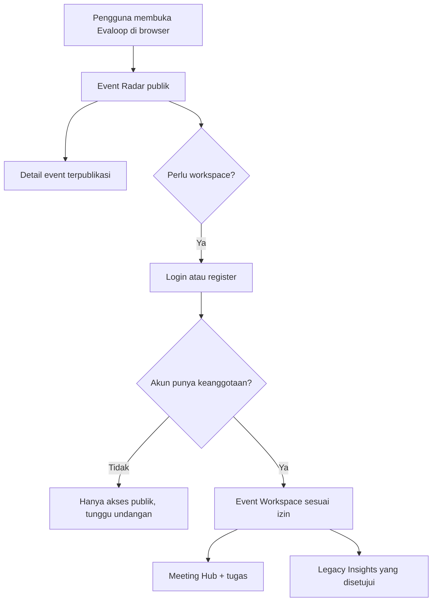
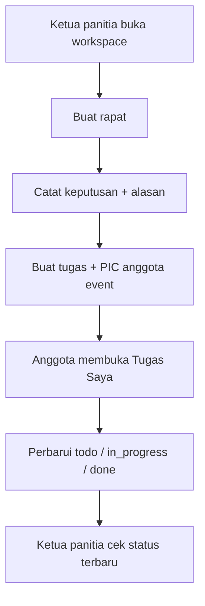
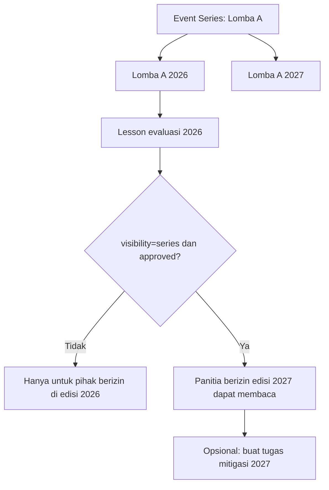
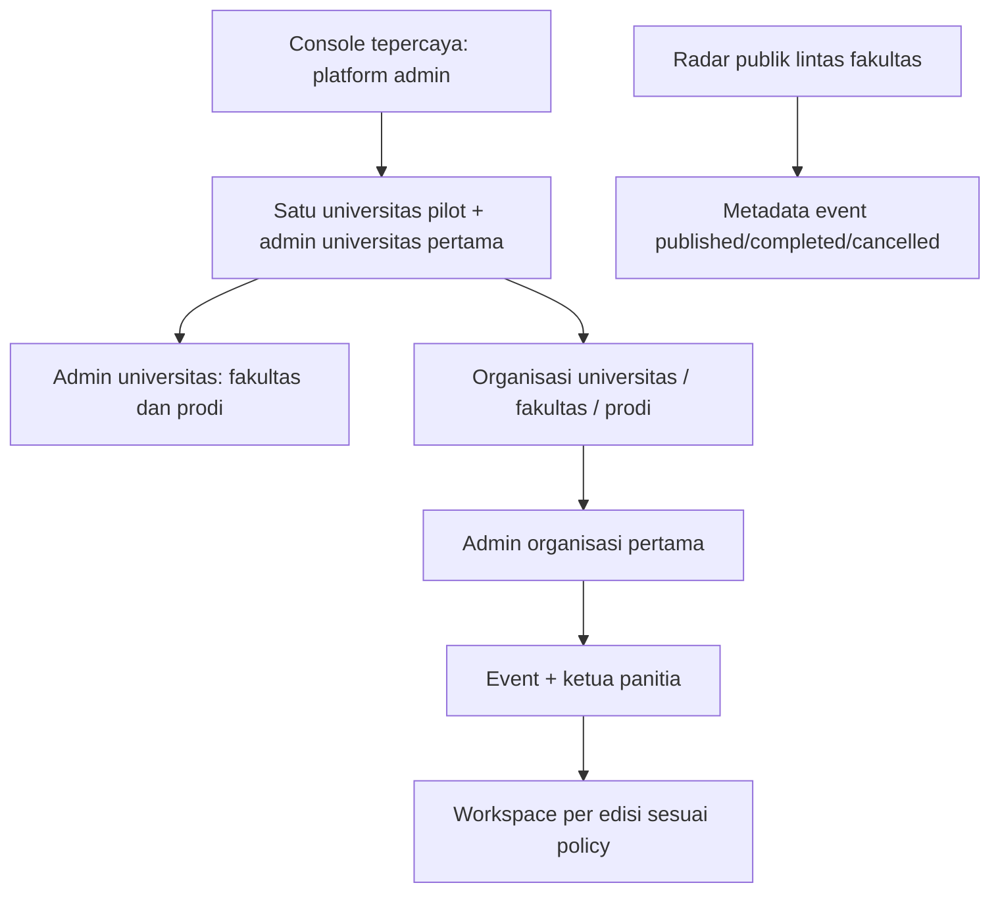

# User Flow & Business Flow — Evaloop v1.1

> Web menangani penemuan kegiatan, administrasi, dan pengelolaan kepanitiaan. Evaloop Android mendampingi alur baca dan pembaruan tugas pribadi melalui backend Laravel yang sama. Bagian 13 menjelaskan perbedaan alur Android dan status perubahan lokal.

## 1. Ringkasan alur web

## 2. Registrasi dan login sederhana

1. Pengguna membuka `Register` dari browser.
2. Memasukkan nama, email, password dan konfirmasi password.
3. Laravel melakukan validasi, menyimpan password **hashed**, lalu login otomatis dan meregenerasi sesi.
4. Pengguna masuk ke dashboard dasar; dapat membuka Event Radar dan opsi workspace **hanya jika** memiliki membership yang ditetapkan admin. Untuk demo, admin memeriksa identitas secara manual sebelum mengundang akun; pendaftaran tanpa verifikasi email tidak membuktikan kepemilikan alamat email.
5. Login berikutnya dengan email/password; logout mengakhiri sesi **per perangkat**.
6. Form web memakai cookie/session dan CSRF Laravel.

## 3. Flow pengunjung/mahasiswa umum

1. Buka Evaloop di browser tanpa login → Event Radar.
2. Cari kegiatan dan gunakan filter periode, tanggal, fakultas, prodi, atau organisasi.
3. Buka metadata event terpublikasi.
4. Untuk workspace, pengguna login dan harus memiliki keanggotaan yang sesuai.

## 4. Flow admin organisasi — event dan collision

1. Login; Laravel memeriksa role admin dan membership organisasi yang active serta masih dalam masa berlaku.
2. Pilih seri event lama atau buat seri baru; event satu kali tidak perlu seri.
3. Buat edisi event **draft**, isi waktu, tempat, dan target prodi.
4. Cek potensi bentrokan terhadap event **terpublikasi** berstatus published/completed; event cancelled dan draft dikecualikan.
5. Jika terdapat peringatan, ubah detail atau tetap lanjut dengan memahami risiko.
6. Publikasikan metadata event dan tunjuk ketua panitia dari akun existing. Admin organisasi atau ketua event kemudian mengelola anggota biasa sesuai policy.
7. Admin organisasi memilih **Tandai selesai** dari Event Saya atau ringkasan workspace, lalu mengonfirmasi. Event berpindah ke riwayat Radar dan arsip workspace tetap tersedia.

## 5. Flow rapat dan tindak lanjut

Satu tugas terkait keputusan (jika ada); tidak semua keputusan wajib punya tugas. Status yang diperbarui terlihat setelah halaman dimuat ulang.

## 6. Flow Legacy antartahun

Ketua atau admin organisasi mengisi evaluasi dan dapat menambahkan lampiran melalui web. Admin organisasi menyetujui evaluasi pada event berseri. Setelah disetujui, evaluasi dan lampirannya menjadi arsip tetap. Panitia berizin di edisi setelahnya membaca evaluasi yang memenuhi syarat dari seri dan organisasi yang sama.

Pada event penerima, ketua atau admin organisasi memilih **Buat Tindak Lanjut**, mengisi judul, memilih PIC dari panitia, dan menetapkan tenggat sebelum event dimulai. Penyimpanan membuat satu tugas berstatus **Belum dimulai** yang terhubung ke evaluasi sumber. Jika tugas sudah ada, pengguna dapat membuka tugas tersebut. Rapat, tugas, dan keanggotaan tetap terpisah per edisi.

## 7. Flow akses tidak sah

1. Anggota panitia A mencoba URL web yang memuat rapat privat event B.
2. Middleware Laravel memeriksa sesi; policy memeriksa relasi event B.
3. Jika tidak berizin, berikan 403/404, tanpa payload privat; antarmuka menampilkan pesan akses ditolak.

## 8. Halaman minimum

- Event Radar dan detail publik.
- Register, login, dan logout.
- Event Saya, Organisasi Saya, dan Tugas Saya.
- Form event dan pemeriksaan bentrokan.
- Rapat, keputusan, dan tugas.
- Legacy Insights.

## 9. Administrasi dan siklus keanggotaan

1. Proses administratif tepercaya menetapkan `is_platform_admin` untuk akun yang telah diperiksa. Tidak tersedia pilihan ini pada register/profil.
2. Admin platform bootstrap satu universitas pilot dan admin universitas pertama melalui proses tepercaya. Admin universitas mengelola struktur fakultas/prodi, membuat organisasi sesuai tingkat dan menetapkan admin organisasi pertamanya secara atomik. Akun penerima harus sudah ada dan membership dimulai pada joined_at yang valid.
3. Admin organisasi mengelola anggota organisasi sendiri: satu record per user, status active/inactive, joined_at, ended_at opsional. Perubahan tidak memberi hak platform admin.
4. Pada setiap request, Laravel mengevaluasi masa berlaku membership; hak organisasi berakhir tepat pada ended_at atau saat inactive. Tidak bergantung pada UI, sesi lama, atau proses scheduler.
5. Admin organisasi membuat event, menunjuk ketua (`coordinator`), dan dapat membaca workspace/arsip organisasi sendiri. Ketua mengelola anggota biasa di event sendiri, tanpa hak admin organisasi.
6. Membership organisasi berakhir tidak otomatis menghapus membership event. Akses event tetap dievaluasi melalui membership event atau kewenangan organisasi yang masih berlaku.
7. Pencabutan panitia menghapus record event membership setelah semua tugas yang merujuk ke anggota itu, termasuk tugas selesai, dialihkan. Sesi yang masih login tidak mempertahankan hak yang telah dicabut.
8. Admin platform maupun admin universitas tidak otomatis berhak membaca workspace privat. Panitia edisi berbeda tetap terpisah dan hanya menerima lesson lintas edisi yang memenuhi policy.

## 10. University MVP v1.1 — alur institusi dan fondasi web

- Pengunjung membuka `/` atau `/events`, menelusuri daftar publik dengan pencarian dan filter, lalu membuka detail kegiatan.
- Register: nama/email/password/konfirmasi → validasi → hash → login sesi → regenerate → dashboard. Tidak memilih universitas, role atau admin.
- Login: email/password → pembatasan percobaan → Auth::attempt → regenerate session → intended dashboard. Logout POST → logout guard → invalidate → regenerate CSRF.
- Dashboard tersedia untuk semua akun login. Organisasi Saya menampilkan organisasi sesuai membership yang berlaku. Kegiatan Saya menampilkan workspace berdasarkan membership event atau hak admin organisasi. Tugas Saya menampilkan tugas akun aktif pada workspace yang masih dapat diakses.
- Workspace event memerlukan event membership atau admin organisasi berlaku; pengelolaan anggota/event organisasi memerlukan admin organisasi berlaku. Role platform/universitas saja tidak cukup.
- Database tidak tersedia menghasilkan halaman layanan tidak tersedia (503), bukan data contoh atau daftar kosong palsu.

## 11. Pengelolaan kegiatan dan workspace di web

1. Admin universitas membuka administrasi organisasi dalam universitasnya dan menetapkan admin organisasi pertama.
2. Admin organisasi mengelola anggota dan seri. Untuk membuat edisi, pilih organisasi dan seri yang sesuai, isi jadwal WITA dan target prodi, lalu simpan draft.
3. Admin organisasi menunjuk ketua. Ketua dan admin organisasi dapat mengelola anggota biasa. Sebelum mencabut anggota, alihkan tugas yang masih merujuk ke anggota tersebut, termasuk tugas selesai.
4. Panitia membuka ringkasan, Meeting Hub, Tugas & Progres, Legacy Insights, dan Panitia sesuai hak akses. Jadwal & Bentrokan tersedia bagi ketua atau admin organisasi yang berwenang.
5. Ringkasan pada kode web lokal menampilkan cuplikan tugas, rapat, dan pembelajaran edisi sebelumnya. Pengelola kegiatan aktif melihat pemeriksaan jadwal, sedangkan anggota biasa melihat cuplikan tugas pribadinya. Rincian selalu mengikuti izin workspace.

## 12. Publikasi dan riwayat kegiatan

Admin organisasi memublikasikan draft dengan jadwal valid. Kegiatan terpublikasi dapat ditandai selesai. Draft dan kegiatan terpublikasi dapat dibatalkan. Kegiatan selesai dan kegiatan batal yang pernah terpublikasi tetap dapat ditemukan pada riwayat Radar. Ringkasan arsip masih dapat dibuka oleh pihak yang berwenang.

Perubahan status tidak menghapus event, kepanitiaan, rapat, tugas, dan evaluasi yang tersimpan. Evaluasi arsip tetap mengikuti alur persetujuan dan pewarisan pada bagian 6.

## 13. Evaloop Android

| Kebutuhan | Alur |
| --- | --- |
| Menjelajahi agenda | Buka aplikasi → Event Radar publik → gunakan pencarian dan filter → buka detail. Login diperlukan untuk membuka workspace privat. |
| Masuk dan membuka profil | Masuk dengan akun Evaloop → buka menu pengguna → lihat profil atau keluar. Tautan **Daftar** membuka form website di browser. |
| Melihat workspace | **Event Saya** → pilih event → **Buka workspace**. Ringkasan menampilkan jadwal, panitia, dan agregat status tugas. |
| Meninjau bentrokan | Ketua atau admin organisasi membuka **Jadwal & bentrokan** dari workspace → baca alasan → buka detail kegiatan pembanding yang publik. |
| Membaca catatan rapat | Workspace → **Meeting Hub** → **Buka catatan** → baca notulen, keputusan, dan detail tugas terkait. |
| Memperbarui tugas pribadi | **Tugas Saya** atau **Tugas & Progres** dari workspace → pilih tugas → pilih status → **Simpan status**. Website membaca status yang sama setelah dimuat ulang. |
| Membaca Legacy | Workspace → **Legacy Insights** → buka evaluasi warisan dan pratinjau gambar privat. PIC dapat membuka detail tugas tindak lanjut miliknya. |

Pembuatan dan penyuntingan rapat, keputusan, evaluasi, serta persetujuan evaluasi dilakukan di web. Source Android sudah memuat form **Buat Tindak Lanjut** untuk pihak berizin. Memuat pilihan PIC dan menyimpan dari form tersebut memerlukan endpoint tambahan yang masih berada di backend lokal. Lihat [kontrak API](API.md#17-tindak-lanjut-legacy-pada-backend-lokal) dan [panduan Android](../mobile/README.md).
